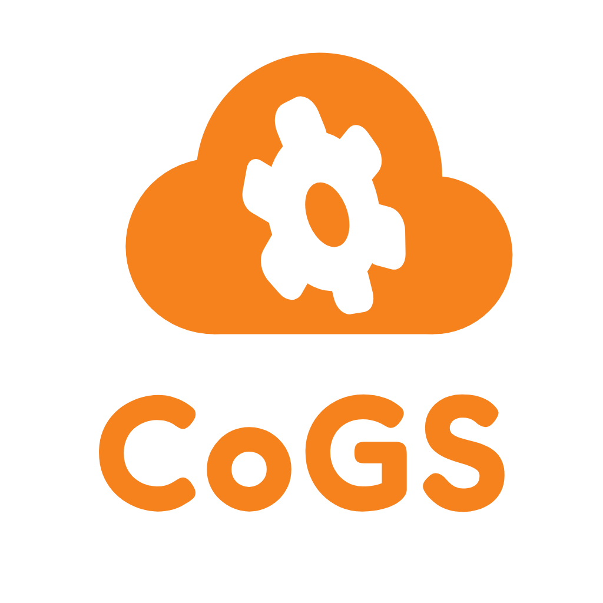

<p align="center"></p>

# Todo app (CoGS reference)

End-to-end demo: **Worker static UI** → **Cloudflare Tunnel** → **Go + SQLite on your host**, with **localStorage offline queue**, **R2 image uploads**, link perf stats, and stress controls.

Config: **`cogs.app.toml`** (`name = "todo"`, `deploy_mode = "push"`). See [docs/deploy.md](../../docs/deploy.md).

## One command (from repo root)

```bash
./cogs launch todo -y          # first-time / full provisioning
./cogs redeploy todo           # fast: UI build, Worker assets, backend release, migrate
```

`launch` runs **npm build** (when `frontend/` exists), **migrate**, **Worker static assets deploy**, **tunnel + DNS**, then starts the API (or writes a release under `.cogs/releases/todo/` on redeploy). Re-runs reuse hostnames from `.env` unless you pass `--pick-zone`.

Local UI dev only: `cd frontend && npm run dev` (API on `:8080`).

## Launch from this directory

```bash
../../cogs launch . -y
```

What `cogs launch` does:

1. **`wrangler login`** if `wrangler whoami` fails  
2. Lists **Cloudflare zones** on your account (apex domains like `example.com`) or lets you type one — you need a site added under **Websites** in the dashboard first  
3. Creates **D1** + **R2** (idempotent)  
4. Creates **tunnel** + **ingress** + **DNS CNAMEs** for `todo-api.<domain>` and `todo.<domain>`  
5. Deploys **Worker static assets** from `public/` to `todo.<domain>`  

**Architecture:** the UI is served from a **Worker** (`todo.<domain>`). The browser talks to the **API** on `todo-api.<domain>`, which uses the **tunnel** to your machine. Both hostnames need DNS — `cogs launch` creates them after you supply a **Zone DNS Edit** token (workspace `.cogs/cloudflare/` or `COGS_CF_API_TOKEN`).
6. Writes **`.env`**, runs **migrate**, starts **`app serve`**

`cogs launch` starts the tunnel in the **background** automatically (`npx wrangler`, no global install).

Manual control:

```bash
../../cogs tunnel start          # from apps/todo (reads cogs.launch.json)
../../cogs tunnel status
../../cogs tunnel stop
../../cogs tunnel run cogs-todo-app   # foreground
```

Fill R2 credentials in `.env` for image uploads. Sync edge reads later:

```bash
cogs sync -env .env --set todos
```

## Docker (optional)

Native **`cogs launch` / `cogs deploy`** stays the default. To run only the API in a container (Linux/CI):

```bash
# repo root
docker build -f apps/todo/Dockerfile -t cogs-todo .
docker compose -f apps/todo/docker-compose.yml up --build
```

See [docs/docker.md](../../docs/docker.md).

## Local-only dev

```bash
cp .env.example .env   # or let launch create .env
go run ./cmd/app migrate -env .env
go run ./cmd/app serve -env .env
```

## Stress scenarios built in

| Scenario | How |
|----------|-----|
| Offline edits | Disable network → add todos → **Flush offline queue** |
| 500-row DB | **Stress: seed 500 todos** |
| Concurrent reads | **Stress: 20 parallel syncs** |
| Large upload | Attach image on a todo (multipart, size limit from `COGS_MAX_UPLOAD_BYTES`) |
| CORS | UI origin must match `COGS_PUBLIC_PAGE_ORIGIN` |

## Tests

```bash
go test ./...
```

Agent-oriented deploy notes: [docs/AGENTS.md](../../docs/AGENTS.md).
